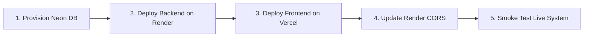

# SkillSwap — Peer-to-Peer Skill Exchange Platform

SkillSwap is a full-stack web application designed for reciprocal, barter-based peer knowledge exchange. Users offer skills they can teach, declare skills they want to learn, discover compatible partners via an automated two-way matchmaking engine, and coordinate skill swaps through structured proposals.

---

## 1. Architecture & Technology Stack

- **Backend**: Spring Boot 4.1.1, Java 21, Spring Data JPA, Spring Security, Hibernate
- **Database**: PostgreSQL (Production: Neon / Render), H2 In-Memory (Automated Integration Tests)
- **Frontend**: React 18, TypeScript, Vite 6, Tailwind CSS v3, React Router 6, Lucide React
- **Cloud Hosting Targets**:
  - **Database**: [Neon](https://neon.tech/) Serverless PostgreSQL
  - **Backend**: [Render](https://render.com/) Web Service (Java runtime)
  - **Frontend**: [Vercel](https://vercel.com/) Static / Edge SPA

---

## 2. Core Features

1. **Authentication & Session Security**:
   - User registration and login with BCrypt password hashing.
   - Server-managed HTTP session cookies (`JSESSIONID`) with `HttpOnly` and configurable `SameSite`/`Secure` attributes.
   - Backward-compatible HTTP Basic authentication support for automated testing and CLI tools.
   - Zero storage of raw passwords, Base64 credentials, or sensitive tokens in browser `localStorage`.
2. **Skill Catalog & User Portfolios**:
   - Searchable global skill taxonomy with pagination.
   - User-managed **Teaching** (`TEACH`) portfolio with self-declared proficiency levels.
   - User-managed **Learning** (`LEARN`) goals.
   - Public user profile views displaying offered and desired skills.
3. **Automated Reciprocal Matchmaking**:
   - Complementary discovery algorithm that pairs User A and User B if and only if User A teaches what User B wants to learn, AND User B teaches what User A wants to learn.
   - Public marketplace to discover skills offered by community members.
4. **Swap Request Workflow**:
   - Structured swap proposal initiation (`POST /api/swaps`).
   - Incoming and outgoing proposal queues.
   - Reciprocal ownership and skill validation (prevents self-swaps, duplicate pending swaps, and mismatched skill trades).
   - State transition lifecycle: `PENDING` &rarr; `ACCEPTED`, `REJECTED`, or `CANCELLED`.

---

## 3. Local Prerequisites & Startup Instructions

### Prerequisites
- **Java**: JDK 21 installed (`JAVA_HOME` pointed to JDK 21)
- **Node.js**: v18+ and `npm` v9+
- **PostgreSQL**: PostgreSQL 14+ (optional for local dev; automated tests run on embedded H2)

### 1. Run the Backend
```bash
# Configure Java 21 environment if not set globally
export JAVA_HOME=/Library/Java/JavaVirtualMachines/jdk-21.jdk/Contents/Home
export PATH="$JAVA_HOME/bin:$PATH"

# Run Spring Boot application locally (defaults to port 8080)
./mvnw spring-boot:run
```
The backend API initializes at `http://localhost:8080`.

### 2. Run the Frontend
```bash
cd frontend
npm install
npm run dev
```
The Vite development server runs at `http://localhost:5173`. In development mode, API requests to `/api` are automatically proxied to `http://localhost:8080` without requiring manual CORS adjustments.

---

## 4. Verification & Build Commands

### Full Backend Test Suite (41 Tests)
```bash
# Executes Auth, SkillMarketplace, and SwapRequest integration test suites on H2
JAVA_HOME=/Library/Java/JavaVirtualMachines/jdk-21.jdk/Contents/Home ./mvnw test
```

### Frontend Production Build
```bash
cd frontend
npm run build
```
Executes TypeScript type-checking (`tsc -b`) and generates production-optimized assets in `frontend/dist/`.

---

## 5. Environment Variables & Configuration

### Backend Environment Variables (Spring Boot on Render)

| Variable Name | Required | Default / Placeholder | Description |
| :--- | :---: | :--- | :--- |
| `PORT` | Auto | `8080` | Server listening port (dynamically injected by Render). |
| `SPRING_DATASOURCE_URL` | **Yes** | `jdbc:postgresql://<neon-subdomain>.neon.tech/neondb?sslmode=require` | Neon PostgreSQL JDBC connection string. **Must start with `jdbc:postgresql://`**. |
| `SPRING_DATASOURCE_USERNAME` | **Yes** | `your_neon_db_username` | PostgreSQL username. |
| `SPRING_DATASOURCE_PASSWORD` | **Yes** | `your_neon_db_password` | PostgreSQL password. |
| `APP_CORS_ALLOWED_ORIGINS` | **Yes** | `https://your-frontend.vercel.app,http://localhost:5173` | Comma-separated list of permitted frontend origins. |
| `SPRING_JPA_SHOW_SQL` | No | `false` | Disable Hibernate SQL queries in production logs. |
| `SPRING_JPA_HIBERNATE_DDL_AUTO`| No | `update` | Hibernate schema management strategy. |
| `SERVER_SERVLET_SESSION_COOKIE_SECURE` | **Yes** | `true` (Render) / `false` (Local) | Enforces `Secure` flag on HTTPS. |
| `SERVER_SERVLET_SESSION_COOKIE_SAME_SITE` | **Yes** | `none` (Cross-origin) / `lax` (Same-site) | SameSite cookie policy. |
| `APP_SECURITY_CSRF_ENABLED` | No | `false` | Enables Spring Security `CookieCsrfTokenRepository`. |

### Frontend Environment Variables (Vite on Vercel)

| Variable Name | Required | Default / Placeholder | Description |
| :--- | :---: | :--- | :--- |
| `VITE_API_BASE_URL` | Direct | `https://your-backend.onrender.com` | Backend origin URL for direct cross-origin API calls. Leave empty if utilizing Vercel rewrites. |

*Templates are maintained in `.env.example` and `frontend/.env.example` with zero live credentials.*

---

## 6. Frontend / Backend Deployment Sequence

Follow this step-by-step sequence to deploy the platform:



### Step 1: Provision Neon PostgreSQL
1. Create a project on [Neon](https://neon.tech/).
2. Copy the JDBC connection string from the Neon dashboard.
   - *Ensure the URL format is*: `jdbc:postgresql://<host>/neondb?sslmode=require`.

### Step 2: Deploy Spring Boot Backend on Render
1. Create a new **Web Service** on Render connected to your GitHub repository.
2. Configure settings:
   - **Runtime**: `Java`
   - **Build Command**: `./mvnw clean package -DskipTests`
   - **Start Command**: `java -jar target/SkillSwap-0.0.1-SNAPSHOT.jar`
3. Add Environment Variables:
   - `SPRING_DATASOURCE_URL`: `<neon-jdbc-url>`
   - `SPRING_DATASOURCE_USERNAME`: `<neon-username>`
   - `SPRING_DATASOURCE_PASSWORD`: `<neon-password>`
   - `SERVER_SERVLET_SESSION_COOKIE_SECURE`: `true`
   - `SERVER_SERVLET_SESSION_COOKIE_SAME_SITE`: `none` (or `lax` if using Vercel rewrites)
   - `SPRING_JPA_SHOW_SQL`: `false`
   - `SPRING_JPA_HIBERNATE_DDL_AUTO`: `update`
4. Deploy the service and note the assigned Render URL (e.g. `https://skillswap-api.onrender.com`).

### Step 3: Deploy Frontend on Vercel
1. Create a new project on [Vercel](https://vercel.com/) linked to your repository.
2. Configure project settings:
   - **Root Directory**: `frontend`
   - **Framework Preset**: `Vite`
   - **Build Command**: `npm run build`
   - **Output Directory**: `dist`
3. Add Environment Variable:
   - `VITE_API_BASE_URL`: `https://skillswap-api.onrender.com`
4. Deploy and obtain your live Vercel domain (e.g. `https://skillswap-ui.vercel.app`).

### Step 4: Link Render CORS Configuration
1. Navigate back to Render &rarr; Environment Variables.
2. Set `APP_CORS_ALLOWED_ORIGINS` to:
   `https://skillswap-ui.vercel.app,http://localhost:5173`
3. Save changes; Render will redeploy with the updated CORS policy.

---

## 7. Security, Cookie, & CSRF Architecture

### Cross-Origin Session Cookies vs. Third-Party Cookie Privacy
When the frontend is hosted on `*.vercel.app` and the backend is hosted on `*.onrender.com`, requests between them are **cross-origin** and **cross-site**.
- For session cookies (`JSESSIONID`) to be transmitted across sites via `fetch(..., { credentials: 'include' })`, the cookie **must** be configured with:
  ```properties
  SERVER_SERVLET_SESSION_COOKIE_SECURE=true
  SERVER_SERVLET_SESSION_COOKIE_SAME_SITE=none
  ```
- **Browser Limitation**: Modern privacy protections (Safari Intelligent Tracking Prevention, Brave Shields, Firefox Enhanced Tracking Protection, and Chrome third-party cookie restrictions) may block cross-site cookies between separate public suffix domains (`vercel.app` vs `onrender.com`).

### Recommended Production Architecture Options:
1. **Option A: Vercel Reverse Proxy Rewrites (Zero-Cookie Blocking)**
   - In `frontend/vercel.json`, rewrite `/api/:path*` to `https://skillswap-api.onrender.com/api/:path*`.
   - The browser communicates solely with `https://skillswap-ui.vercel.app/api/...`, making all requests first-party.
   - `SameSite=Lax` can be retained, completely bypassing third-party cookie restrictions.
2. **Option B: Custom Domain**
   - Bind a custom domain (e.g., `skillswap.com` for frontend and `api.skillswap.com` for backend). Because they share the same apex domain, cookies remain same-site.
3. **Option C: Direct Cross-Origin with `SameSite=None`**
   - Set `SERVER_SERVLET_SESSION_COOKIE_SAME_SITE=none` and `SERVER_SERVLET_SESSION_COOKIE_SECURE=true`. Works seamlessly across standard desktop Chrome, Edge, and browsers allowing cross-origin cookies.

### CSRF Protection Analysis
- Under **`SameSite=Lax`** (Option A/B above), modern browsers strictly withhold session cookies on cross-site state-changing requests (`POST`, `PUT`, `DELETE`), preventing CSRF at the browser network layer.
- For defense-in-depth, `app.security.csrf.enabled` can be set to `true`. When active:
  - Spring Security generates an `XSRF-TOKEN` cookie via `CookieCsrfTokenRepository`.
  - The frontend [`ApiClient`](frontend/src/services/api.ts) automatically reads `XSRF-TOKEN` and injects it into `X-XSRF-TOKEN` headers.
  - An introspection endpoint `GET /api/auth/csrf` is provided for client handshake.

---

## 8. Post-Deployment Smoke-Testing Checklist

Once deployed to Render, Neon, and Vercel, run through this verification checklist:

- [ ] **Health & Connectivity**:
  - Visit `https://your-backend.onrender.com/api/skills` &rarr; verify HTTP 200 JSON response with empty or populated catalog.
- [ ] **CORS Verification**:
  - Open DevTools Network tab on your Vercel frontend &rarr; verify `OPTIONS` preflight requests succeed with `Access-Control-Allow-Origin` matching your Vercel URL.
- [ ] **User Registration**:
  - Navigate to `/register` &rarr; submit a new user account &rarr; verify automatic session establishment and redirect to `/dashboard`.
- [ ] **Skill Portfolio**:
  - Navigate to `/skills` &rarr; add a **Teaching** skill (e.g., "Python", Advanced).
  - Add a **Learning** skill (e.g., "UI Design", Beginner).
- [ ] **Discovery & Matches**:
  - Register a second user in an incognito window offering "UI Design" and wanting to learn "Python".
  - Navigate to `/matches` on both accounts &rarr; verify reciprocal match appears with swap proposal action.
- [ ] **Swap Workflow Lifecycle**:
  - User A submits a swap proposal with a customized message.
  - User B navigates to `/swaps` &rarr; views incoming request &rarr; clicks **Accept**.
  - Verify status updates to `ACCEPTED` in real-time across both accounts.
- [ ] **Logout & Session Invalidation**:
  - Click **Sign Out** &rarr; verify redirect to landing page.
  - Attempt manual navigation to `/dashboard` &rarr; verify `ProtectedRoute` blocks access and redirects to `/login`.
